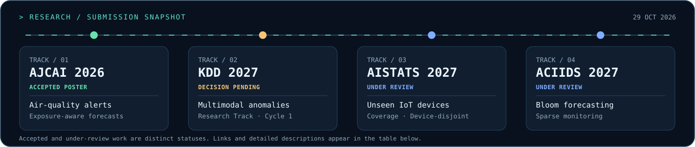

<!--
  GITHUB PROFILE / AI RESEARCH TERMINAL
  Visual assets: ./assets/ | Setup: ./SETUP.md
  Accessibility: actual text and research status are preserved below the visuals.
-->

<picture>
  <source media="(prefers-color-scheme: dark)" srcset="./assets/profile-banner-dark.svg">
  <source media="(prefers-color-scheme: light)" srcset="./assets/profile-banner-light.svg">
  
</picture>

  <picture>
    <source media="(prefers-color-scheme: dark)" srcset="./assets/typing-dark.svg">
    <source media="(prefers-color-scheme: light)" srcset="./assets/typing-light.svg">
    
  </picture>

<h1 align="center">Huynh Quoc Viet</h1>

<strong>AI Researcher &amp; Machine Learning Engineer · AI Tech Lead at SpeedyLabX</strong>

Ho Chi Minh City, Vietnam · B.Eng. in Artificial Intelligence, FPT University · Expected January 2027

  <a href="https://2uocvi3t-portfolio.vercel.app/">Portfolio</a> ·
  <a href="https://2uocvi3t-portfolio.vercel.app/cv/ATS_Resume_master.pdf">Master CV</a> ·
  <a href="https://www.linkedin.com/in/quoc-viet-huynh/">LinkedIn</a> ·
  <a href="https://orcid.org/0009-0003-8727-9998">ORCID</a> ·
  <a href="mailto:tyviet1609@gmail.com">Email</a>

---

## `> whoami` · Research identity

I turn research questions into **reproducible AI systems**. My work spans **conformal prediction, multimodal time series, computer vision and reinforcement learning**, with an emphasis on evaluation protocols, calibration and the limits of each result.

> **Research → Reproduce → Evaluate**  
> From explicit assumptions to auditable evidence and working systems.

## `> research --status` · Research

Co-author of an **accepted AJCAI 2026 poster**, with further manuscripts under review. I work on methods whose assumptions, evaluation splits and failure cases can be inspected alongside their results.

<picture>
  <source media="(prefers-color-scheme: dark)" srcset="./assets/research-pipeline-dark.svg">
  <source media="(prefers-color-scheme: light)" srcset="./assets/research-pipeline-light.svg">
  
</picture>

| Study | Status and focus |
| :--- | :--- |
| [**Health-centred air-quality alerts**](https://openreview.net/forum?id=DBK3KG9MRL) | **AJCAI 2026 · Accepted poster** Exposure-aware forecasting and calibration audits using Canterbury and Melbourne observations. |
| [**Multimodal anomaly detection**](https://openreview.net/forum?id=PdF6Aohiel) | **KDD 2027 · Research Track, Cycle 1 · Decision pending** Conformal calibration, missing-modality robustness and counterfactual attribution for time series. |
| [**Coverage on unseen IoT devices**](https://openreview.net/forum?id=GdQdFzL4P8) | **AISTATS 2027 · Under review** Device-disjoint evaluation and distribution-free coverage of attack classes. |
| [**Bloom forecasting under sparse monitoring**](https://openreview.net/forum?id=FZXBvl7pE9) | **ACIIDS 2027 · Under review** Site-held-out forecasting, data provenance and the limits of multi-source fusion. |

Explore the [**portfolio research section**](https://2uocvi3t-portfolio.vercel.app/#research) for methods, figures and results. **Under-review manuscripts are not presented as accepted papers.**

## `> ls ./selected-systems` · Selected systems

### [FitSync](https://github.com/Team-SafeTrail/fitsync-app)
**Project Lead · Product & OCR · In development**

Leading a five-person team building a personal-training workspace with Next.js and Supabase/PostgreSQL. Work includes tenant-isolated profiles, trainee invitations, InBody review, meal-photo check-ins and progress tracking. The OCR workflow retains coach review and a manual fallback; benchmark work is in progress.

### [BioListen VN](https://github.com/hei1sme/BioListen-VN)
**AI & Technical Lead · NeuraX.ai · VAIC 2026, Stage 1 Top 10**

Built the audio-model pipeline for a three-person team's ecological-monitoring prototype: dual-head EfficientNet-V2-S, masked multi-task learning, ONNX export and Grad-CAM. The model covers three ecological groups and nine threat/background classes. The dashboard demonstrates the competition prototype.

### [Adaptive Preference MORL](https://github.com/Am2uocVi3t/REL301m_AdaptivePreferenceMORL)
**Research Engineer · Experiments in progress**

Preference-conditioned vector Q-learning with per-head Double-DQN targets and adaptive preference allocation. Evaluation uses paired seeds, separate training/validation/test preferences and compute-matched controls on MO-LunarLander and Minecart.

### [PPE Detection](https://github.com/DPL302m-Group03/PPE-Detection)
**Deep Learning Engineer · Computer vision**

Combined nine public datasets into a nine-class detection schema, compared YOLOv8 and RT-DETR models, and built Streamlit image, webcam and video workflows with compliance checks and annotated-video export. [**Watch the demo**](https://github.com/DPL302m-Group03/PPE-Detection/blob/main/data/demos/UNSAFE.gif).

**More work:** [Face Recognition Attendance](https://github.com/Am2uocVi3t/Attendance_System) · [Dynamic Traffic Management](https://github.com/Am2uocVi3t/Dynamic_Traffic_Management) · [Flood Risk Research](https://github.com/Am2uocVi3t/DAP391m_Research)

## `> cat experience.log` · Experience

**SpeedyLabX — AI Tech Lead · AI Research**  
*November 2025–Present*

Study related work, develop research directions, design reproducible evaluations and co-author conference submissions across time series, conformal prediction and environmental forecasting.

**Outlier, Project Aether — Contributor · Freelance via Upwork**  
*June–October 2026 · Completed*

Labelled and validated data, held spoken Vietnamese conversations with two AI models, and evaluated responses against Audio Quality, Naturalness/Engagement, Utility and Conversation Dynamics.

**Kỷ Nguyên Số — AI Research Intern · University OJT**  
*January–May 2026 · General Era Digital Solution Joint Stock Company*

Studied Federated Learning, Continual Learning, Federated Continual Learning and Edge AI. Reviewed federated class-, domain- and task-continual learning, including data heterogeneity, forgetting and edge resource constraints.

## `> cat stack.yml` · Toolkit

**Research & modelling:** Python, PyTorch, TensorFlow/Keras, scikit-learn, conformal prediction, time-series analysis, OpenCV, YOLO, reinforcement learning.

**Engineering:** FastAPI, Streamlit, Next.js, TypeScript, PostgreSQL, Supabase, Docker, Git, Linux, Weights & Biases.

**Data & writing:** Pandas, NumPy, SQL, LaTeX.

## `> ./connect.sh` · Let's connect

Open to research, machine learning engineering and collaborative AI projects. [**Email me**](mailto:tyviet1609@gmail.com) or [**connect on LinkedIn**](https://www.linkedin.com/in/quoc-viet-huynh/).

---

Research and project statuses updated October 29, 2026. Submitted manuscripts are listed separately from accepted work. Visuals are original, self-hosted SVG assets; no JavaScript or third-party animation service required. See <a href="./SETUP.md">SETUP.md</a> for deployment and maintenance.
